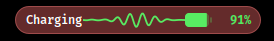
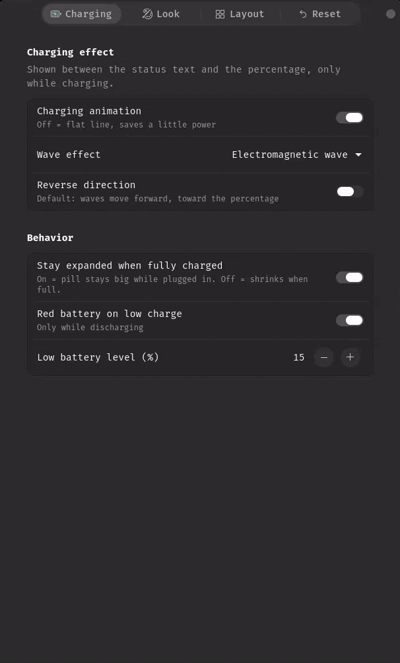
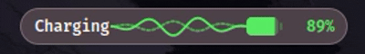

<div align="center">

# Butu

**A dynamic charging pill for the GNOME Shell top panel.**

Compact battery percentage while you run on battery. When you plug in, the pill expands and shows a live charging animation.


-yellow)

</div>

---

## Table of contents

- [Overview](#overview)
- [Features](#features)
- [Screenshots](#screenshots)
- [Requirements](#requirements)
- [Installation](#installation)
- [Usage](#usage)
- [Settings reference](#settings-reference)
- [Charging effects](#charging-effects)
- [Battery icon styles](#battery-icon-styles)
- [Dynamic border](#dynamic-border)
- [How it works](#how-it-works)
- [Performance design](#performance-design)
- [Project structure](#project-structure)
- [Development](#development)
- [Packaging and publishing](#packaging-and-publishing)
- [Troubleshooting](#troubleshooting)
- [FAQ](#faq)
- [Roadmap](#roadmap)
- [Contributing](#contributing)
- [Credits](#credits)
- [License](#license)

---

## Overview

**Butu** is a GNOME Shell extension that puts a small "pill" in the top panel, in the style of Dynamic-Island-like music pills.

- **On battery:** the pill is small and shows only the remaining charge (percentage plus a battery icon).
- **On charger:** the pill smoothly grows and shows a status text (`Charging`), an animated wave, the percentage and the battery icon.
- **Unplugged:** the animation stops by itself and the pill shrinks back.

Everything is configurable from a native GNOME preferences window: colors, size, battery icon style, wave effect, border, spacing and pixel-level placement.

## Features

- **Charge-aware pill**
  - Compact mode while discharging, expanded mode while charging.
  - Smooth width animation between the two modes.
  - Optional "stay expanded when fully charged" (on/off, no time limit).
  - Low battery state (red battery and percentage below a threshold you choose).
- **9 charging wave effects**, all moving forward toward the percentage (optional reverse switch):
  sine, cosine, analog signal, digital signal, transverse, electromagnetic, seismic, radio, periodic.
- **7 battery icon styles:** iOS, One UI, ColorOS, EMUI, Classic outline, Circle (clockwise), Circle (anticlockwise).
- **Dynamic colors**
  - Background: classic black, wallpaper-derived color, or custom color.
  - Separate accent color for percentage, battery and waves.
- **Optional dynamic border** (thin outline) that follows charge state, battery level, wallpaper color, or a custom color.
- **Full size control:** compact width, expanded width, height, corner radius, text size and battery icon size.
- **Pixel-level placement:** X/Y offsets for battery icon, percentage and status text, plus spacing and padding controls and an option to put the battery icon before the percentage.
- **Panel position:** left, center or right box, with order index.
- **One-click reset** of every setting to default.
- **Light by design:** event-driven battery updates, no polling, animation timer only while charging.

## Screenshots


| Charging | Discharging (compact) |
|---|---|
|  |  |

| Preferences | Wave effects |
|---|---|
|  | |

## Requirements

| Item | Requirement |
|---|---|
| GNOME Shell | 50 (declared in `metadata.json`) |
| Session | Wayland (GNOME 50 is Wayland-only) |
| Battery data | UPower service (`org.freedesktop.UPower`), present on standard GNOME installs |
| Hardware | A laptop battery. On machines without a battery the pill hides itself. |
| Build tools (optional) | `glib-compile-schemas` (package `libglib2.0-bin` on Ubuntu/Debian) |

To support other GNOME versions, add them to `shell-version` in `metadata.json` after testing.

## Installation

### Install by cloning 
1. Clone the repository in a directory:

```bash
cd butu
```
2. Navigate to the cloned directory:
```bash
cd butu
```
4. Make the install.sh script executable:
```bash
chmod +x install.sh
```
4. Run the installation command:
```bash
./install.sh
```

The script copies the extension to `~/.local/share/gnome-shell/extensions/butu@toxic` and compiles the settings schema.

Then **log out and log back in** (GNOME on Wayland cannot restart the shell in place) and enable it:

```bash
gnome-extensions enable butu@toxic
```

### Install by zip file
1. Download the .zip file.
2. Unzip the file:
```bash
unzip butu-main
```
3.Navigate to the cloned directory:
```bash
cd butu-main
```
4.Make the install.sh script executable:
```bash
chmod +x install.sh
```
5. Run the installation command:
```bash
./install.sh
```
Then **log out and log back in** (GNOME on Wayland cannot restart the shell in place) and enable it:

### Uninstalling

```bash
gnome-extensions disable butu@toxic
gnome-extensions uninstall butu@toxic
```

## Usage

1. Enable the extension. The pill appears in the top panel (center box by default).
2. Open settings:
   ```bash
   gnome-extensions prefs butu@toxic
   ```
   or use the **Extensions** app and click the gear next to Butu.
3. Plug in the charger and watch the pill expand. Unplug and it shrinks back.

### Pill states

| Battery state (UPower) | Pill | Animation |
|---|---|---|
| Charging | Expanded, text `Charging` | Wave runs |
| Fully charged, plugged in | Expanded (if *Stay expanded* is on), text `Charged`; otherwise compact | Off, flat line |
| Pending charge, plugged in | Same as fully charged, text `Plugged` | Off, flat line |
| Discharging | Compact, percentage and battery icon | Off |
| Discharging and below low threshold | Compact, red battery and percentage | Off |
| No battery present | Pill hidden | Off |

## Settings reference

All options live in the GSettings schema `org.gnome.shell.extensions.butu`. You can also change them from the terminal:

```bash
gsettings --schemadir ~/.local/share/gnome-shell/extensions/butu@toxic/schemas \
  set org.gnome.shell.extensions.butu wave-effect 'radio'
```

### Charging

| Key | Type | Default | Description |
|---|---|---|---|
| `animation-enabled` | bool | `true` | Run the wave animation while charging. Off shows a flat line. |
| `wave-effect` | string | `sine` | `sine`, `cosine`, `analog`, `digital`, `transverse`, `electromagnetic`, `seismic`, `radio`, `periodic` |
| `wave-reverse` | bool | `false` | Reverse wave direction (default is forward, toward the percentage). |
| `stay-expanded` | bool | `true` | Keep the pill expanded while plugged in and fully charged. No time limit. |
| `low-color-enabled` | bool | `true` | Red battery and percentage when low (discharging only). |
| `low-threshold` | int | `15` | Low battery percentage (5 to 50). |

### Look

| Key | Type | Default | Description |
|---|---|---|---|
| `color-mode` | string | `classic` | Pill background: `classic` (black), `wallpaper`, `custom` |
| `custom-color` | string | `rgb(53,132,228)` | Background used in `custom` mode |
| `accent-color` | string | `rgb(88,235,98)` | Percentage, battery and wave color while charging |
| `battery-style` | string | `ios` | `ios`, `oneui`, `coloros`, `emui`, `classic`, `circle-cw`, `circle-ccw` |
| `battery-size` | int | `27` | Battery icon size in px (10 to 60) |
| `border-enabled` | bool | `false` | Draw the thin border |
| `border-mode` | string | `state` | `state`, `level`, `wallpaper`, `custom` |
| `border-color` | string | `rgb(255,255,255)` | Used in `custom` border mode |
| `border-width` | int | `1` | Border width in px (1 to 4) |
| `border-opacity` | int | `70` | Border opacity in percent (10 to 100) |

### Layout

| Key | Type | Default | Description |
|---|---|---|---|
| `compact-width` | int | `84` | Pill width while not charging (px) |
| `expanded-width` | int | `280` | Pill width while charging (px) |
| `pill-height` | int | `30` | Pill height (px), automatically capped to the panel height |
| `corner-radius` | int | `15` | Corner radius (px) |
| `font-size` | int | `12` | Text size (px) |
| `padding-x` | int | `14` | Inner left/right padding (px) |
| `gap-pct-battery` | int | `6` | Space between percentage and battery icon (px) |
| `gap-wave` | int | `6` | Space around the wave (px) |
| `battery-first` | bool | `false` | Put the battery icon before the percentage |
| `battery-offset-x` / `battery-offset-y` | int | `0` | Move battery icon (X: -40..40, Y: -15..15) |
| `pct-offset-x` / `pct-offset-y` | int | `0` | Move percentage text |
| `status-offset-x` / `status-offset-y` | int | `0` | Move status text (`Charging`) |
| `position` | string | `center` | Panel box: `left`, `center`, `right` |
| `position-index` | int | `0` | Order inside the box (`0` first, `-1` last) |

> **Minimum widths:** the compact and expanded width sliders automatically get a lower limit based on font size, icon size, spacing and padding, so a slider never silently does nothing.

### Reset

The **Reset** page restores every key to its default. From the terminal:

```bash
gsettings --schemadir ~/.local/share/gnome-shell/extensions/butu@toxic/schemas \
  reset-recursively org.gnome.shell.extensions.butu
```

## Charging effects

The wave sits between the `Charging` text and the percentage. It runs **only while the battery state is charging**. All waves travel **forward** (left to right, toward the percentage) unless *Reverse direction* is enabled.

| Effect | Description |
|---|---|
| Sine wave | One smooth sine wave traveling forward |
| Cosine wave | Cosine wave with a faint trailing echo |
| Analog signal | Sum of several harmonics plus small jitter, like an oscilloscope trace |
| Digital signal | Scrolling square pulse train (bit pattern) |
| Transverse wave | Particles (dots) moving up and down as the wave passes |
| Electromagnetic wave | Solid electric-field wave plus a dashed magnetic-field wave |
| Seismic wave | Quiet baseline, then a shaking burst front with a decaying tail |
| Radio wave | Amplitude-modulated carrier wave |
| Periodic wave | Triangle wave |

All animation loops use integer multiples of the base period, so loops are seamless.

## Battery icon styles

| Style | Look |
|---|---|
| `ios` | Soft rounded body with solid fill and small terminal |
| `oneui` | Rounded outline, inset fill, small round terminal |
| `coloros` | Capsule outline with capsule fill |
| `emui` | Squarer outline, inset fill, taller terminal |
| `classic` | Plain outline battery |
| `circle-cw` | Ring that fills clockwise from the top |
| `circle-ccw` | Ring that fills anticlockwise from the top |

The shapes are inspired by each vendor's style, not pixel-exact copies. Contributions that refine them or add more styles are welcome.

## Dynamic border

An optional thin outline around the pill (off by default).

| Mode | Border color |
|---|---|
| `state` | Accent while plugged in, red when low, soft foreground color otherwise |
| `level` | Smoothly shifts from red (0%) to green (100%) with battery level |
| `wallpaper` | Lightened average color of the current wallpaper |
| `custom` | Any color you pick |

Width (1 to 4 px) and opacity are adjustable.

## How it works

```
UPower (system D-Bus)
        |  g-properties-changed signal
        v
  src/battery.js  -- Percentage, State, IsPresent (only emits on real change)
        |
        v
  src/pill.js     -- builds the St widgets, state machine, drawing, animation
        |
        +-- src/layout.js   -- pill/icon/text dimensions (shared with prefs)
        +-- src/color.js    -- color parsing, wallpaper averaging, HSL helpers
```

- **Battery data:** a `Gio.DBusProxy` on `org.freedesktop.UPower` at `/org/freedesktop/UPower/devices/DisplayDevice`. The extension only reads `Percentage`, `State` and `IsPresent`.
- **Rendering:** the pill is an `St.Widget` mounted into the panel's left, center or right box. Battery icon and waves are drawn with Cairo via `St.DrawingArea`.
- **Expand/shrink:** `ease()` animates the body width and the left section (text plus wave) opacity and width.
- **Wallpaper color:** the wallpaper is decoded asynchronously at 48 px, averaged once, tuned for readability and cached. It is recomputed only when the wallpaper or light/dark mode changes.
- **Settings:** GSettings (`schemas/`), edited through an Adwaita preferences window (`prefs.js`). Changes apply live.

## Performance design

Butu is built to stay out of the way:

- **No polling.** Battery updates arrive as D-Bus signals; unchanged values are ignored.
- **No timers while idle.** The only timer is a ~30 FPS redraw tick that exists **only while charging with animation enabled**. It is removed as soon as charging stops, the animation is turned off, or the extension is disabled.
- **Small drawing work.** Waves are a few hundred line segments at most; the battery icon is a handful of Cairo calls.
- **Tiny wallpaper decode.** 48 px, asynchronous, cached.
- **Clean teardown.** `disable()` removes the actor, the D-Bus proxy, all signal connections, timers and pending async operations.

If you want even less activity, turn **Charging animation** off. The pill then draws a static line and uses no timer at all.

## Project structure

```
butu@toxic/
├── extension.js        # entry point: enable() / disable()
├── prefs.js            # preferences window (libadwaita)
├── metadata.json       # extension metadata (uuid, shell-version, schema)
├── stylesheet.css      # minimal CSS (label weights, container margin)
├── install.sh          # local install helper
├── README.md
├── schemas/
│   └── org.gnome.shell.extensions.butu.gschema.xml
└── src/
    ├── battery.js      # UPower proxy wrapper
    ├── color.js        # color helpers and wallpaper averaging
    ├── layout.js       # shared size calculations
    └── pill.js         # the pill: widgets, drawing, state, animation
```

## Development

### Set up

```bash
git clone https://github.com/<your-github-username>/butu.git
cd butu
./install.sh
```

Or symlink for faster iteration:

```bash
ln -s "$PWD" ~/.local/share/gnome-shell/extensions/butu@toxic
glib-compile-schemas schemas
```

### Reload

GNOME on Wayland cannot reload extension code in the running shell. Options:

- Log out and back in after each change, or
- Test in a nested shell (needs the GNOME devkit packages):

```bash
dbus-run-session -- gnome-shell --devkit
```

Prefs changes can be tested without restarting the shell:

```bash
gnome-extensions prefs butu@toxic
```

### Logs

```bash
journalctl -f -o cat /usr/bin/gnome-shell | grep -i butu
```

Or use **Looking Glass** (`Alt+F2`, type `lg`, Enter) to inspect errors and extensions.

### Quick checks

```bash
# syntax check (ES modules)
for f in extension.js prefs.js src/*.js; do cp "$f" /tmp/check.mjs && node --check /tmp/check.mjs; done

# schema validation
glib-compile-schemas --strict schemas
```

### Code style

- ES modules, `const`/`let`, 4-space indent.
- No synchronous I/O, no blocking calls in the shell process.
- Every signal, timer and async operation created in `enable()` or the pill must be cleaned up in `disable()` / `destroy()`.
- Do not add polling. Prefer signals.
- New settings: add the key to the schema (with range/choices and default), wire it in `src/pill.js` (`_connect`), expose it in `prefs.js`, and document it in this README.

## Packaging and publishing

Create a distributable zip:

```bash
gnome-extensions pack \
  --force \
  --extra-source=src \
  --schema=schemas/org.gnome.shell.extensions.butu.gschema.xml \
  .
```

Before submitting to [extensions.gnome.org](https://extensions.gnome.org):

- Read the [review guidelines](https://gjs.guide/extensions/review-guidelines/review-guidelines.html).
- Remove `install.sh` from the submitted zip if it is not needed.
- Make sure the license is GPL-compatible and a `LICENSE` file is included.
- Test enable/disable repeatedly and check logs for leaks and errors.
- Use a unique, stable `uuid` and keep `shell-version` accurate.

## Troubleshooting

| Problem | Fix |
|---|---|
| Extension does not appear after install | Log out and log in (Wayland), then `gnome-extensions enable butu@toxic` |
| `gnome-extensions enable` says extension not found | Check the folder name matches the uuid: `~/.local/share/gnome-shell/extensions/butu@toxic` |
| State shows `ERROR` in the Extensions app | Run the log command above and read the error. Often a wrong `shell-version` or a missing compiled schema. |
| Preferences window does not open | Run `glib-compile-schemas schemas` in the extension folder, then retry |
| Pill is not visible | Check `position` / `position-index`; try `left` or `right`; make sure the machine has a battery |
| Pill overlaps another top bar item | Change **Order in area** or **Panel area** in Layout |
| Pill is clipped vertically | Height is capped to the panel height. Lower the height or increase panel height with your theme. |
| Wallpaper color is gray or wrong | Dynamic or XML wallpapers cannot be sampled and fall back to black. Use a normal image or choose Custom color. |
| Width slider seems stuck | It cannot go below the minimum for the current font, icon size, spacing and padding. Reduce those first. |
| No animation | Check **Charging animation** is on and the battery state is actually *charging* (not full or pending). |

## FAQ

**Does it work on X11?**
GNOME 50 removed the X11 session. On older GNOME versions with X11 you can restart the shell with `Alt+F2`, `r`, Enter after adding the version to `metadata.json`.

**Does it work on desktops without a battery?**
The pill hides itself when UPower reports no battery.

**Will it drain my battery?**
There is no polling. While discharging there are no timers. While charging, a light redraw tick runs, and you can disable the animation completely.

**Can I use my own colors?**
Yes: custom background, accent color and border color.

**Can I move the icon or text by a few pixels?**
Yes: Layout page, **Fine offsets**.

**Can I add my own wave or battery style?**
Yes. See [Contributing](#contributing).

## Roadmap

Ideas, not promises:

- More battery styles (MIUI, Pixel, and others)
- Optional bolt overlay on the battery icon
- More wave effects and per-effect speed setting
- Optional time-remaining text
- Optional sounds or notifications on plug/unplug
- Translations (gettext)
- Support for more GNOME Shell versions
- Screenshot gallery and demo GIFs

## Contributing

Contributions are welcome.

1. Fork the repository and create a branch: `git checkout -b feature/my-change`
2. Make your change following the [code style](#code-style).
3. Test: enable, disable, enable again; change settings live; check the logs.
4. Update this README if you added or changed a setting.
5. Open a pull request with a clear description and, for visual changes, a screenshot or GIF.

### Adding a wave effect

1. Add a `<choice>` to `wave-effect` in the schema.
2. Add a `case` in `_drawWave()` in `src/pill.js`. Keep it moving **forward** (`k * x - t`) and use integer multiples of `t` so the loop is seamless.
3. Add the entry to the combo in `prefs.js` and to the table in this README.

### Adding a battery style

1. Add a `<choice>` to `battery-style` in the schema.
2. Add a `case` in `_drawBattery()` in `src/pill.js`.
3. Add the entry to the combo in `prefs.js` and to the table in this README.

### Reporting bugs

Please include:

- GNOME Shell version (`gnome-shell --version`) and distro
- Steps to reproduce
- Relevant log lines (see [Logs](#logs))
- A screenshot if it is a visual problem

## Credits

- Inspired by dynamic-music-pill for the GNOME panel.
- https://github.com/Andbal23/dynamic-music-pill
- Built with [GJS](https://gjs.guide), [St](https://gjs-docs.gnome.org/st13~13/), [Clutter](https://gjs-docs.gnome.org/clutter13~13/), [Cairo](https://gjs-docs.gnome.org/cairo10~1.0/) and [libadwaita](https://gnome.pages.gitlab.gnome.org/libadwaita/).
- Battery data from [UPower](https://upower.freedesktop.org/).
- Battery style names (iOS, One UI, ColorOS, EMUI and others) belong to their respective owners. Butu draws its own original icons inspired by those styles and is not affiliated with them.

## License

Butu is free software: you can redistribute it and/or modify it under the terms of the **GNU General Public License** as published by the Free Software Foundation, either version 3 of the License, or (at your option) any later version.

It is distributed in the hope that it will be useful, but **without any warranty**; without even the implied warranty of merchantability or fitness for a particular purpose. See the [GNU General Public License](https://www.gnu.org/licenses/gpl-3.0.html) for details.

Add a `LICENSE` file with the full GPL-3.0 text to the repository root.
